## Operaciones basicas con opencv en python
## Alumna Angela Correa NC = 0037
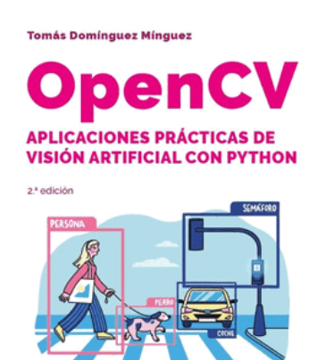
## 1. LECTURA DE LA IMAGEN DESDE LA CARPETA
#### Cuando no puede cargar la imagen
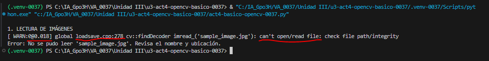
#### Cuando puede leer la imagen
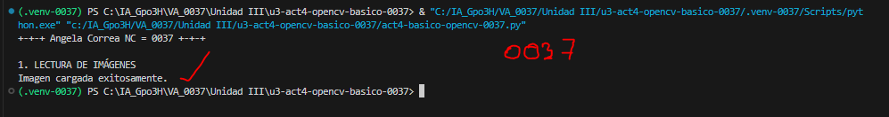
## 2. PROPIEDADES DE LA IMAGEN
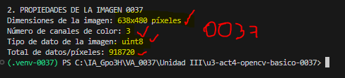
#### Mostrando imagen original

#### en la terminal
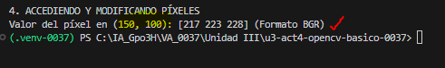
## 4. ACCESO Y MODIFICACIÓN DE PÍXELES INDIVIDUALES
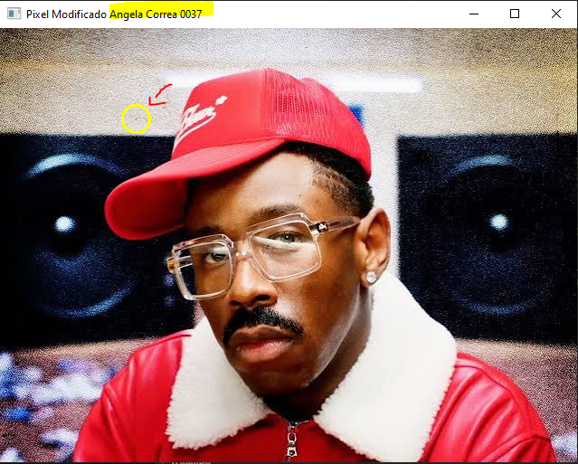
## 5. REGIÓN DE INTERÉS (ROI - REGION OF INTEREST)
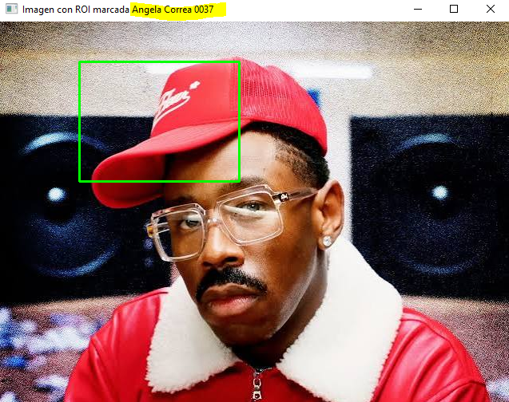
#### ROI Extraida (Recorte)
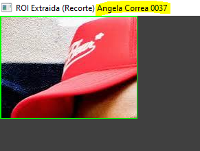
## 6. SEPARACIÓN Y FUSIÓN DE CANALES DE COLOR (BGR)
#### 3 ventanas en blanco y negro.
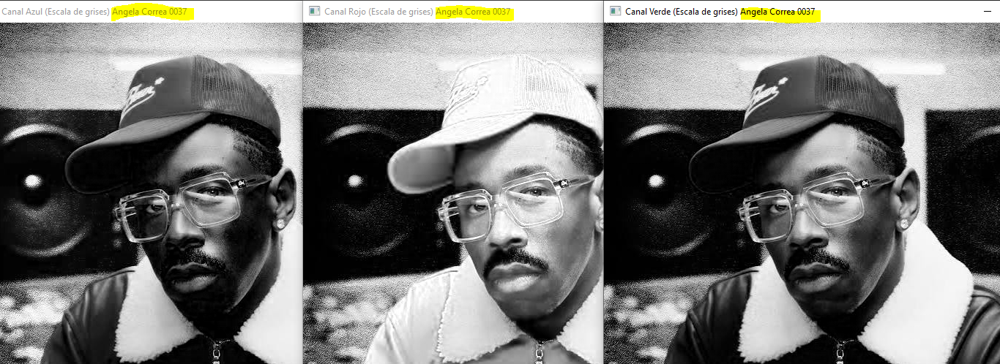
#### 3 ventanas en azul, verde y rojo.
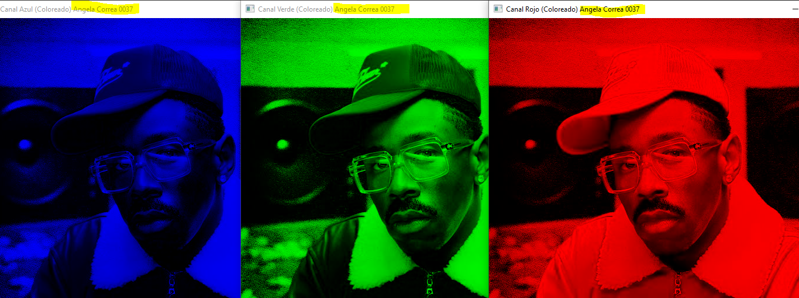
## 7. REDIMENSIONAMIENTO DE IMÁGENES (RESIZING)
#### Redimensionada a 400x300
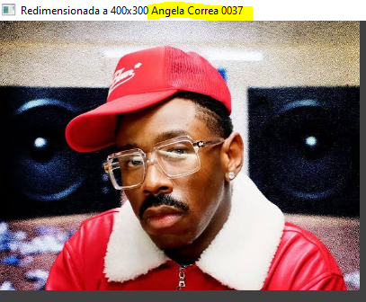
#### Mitad de tamano (0.5x)
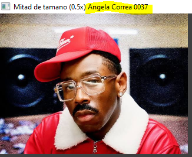
#### Ampliada (1.5x)

## 8. ROTACIÓN DE IMÁGENES
#### Imagen Rotada (45 grados)
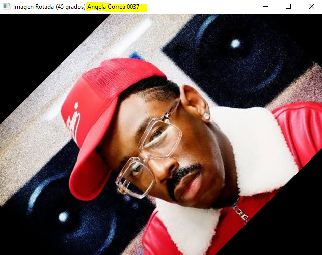
## 9. VOLTEO / ESPEJO DE IMÁGENES (FLIPPING)
#### Volteo Horizontal (Espejo)

#### Volteo Vertical (De cabeza)

#### Volteo en Ambos Ejes
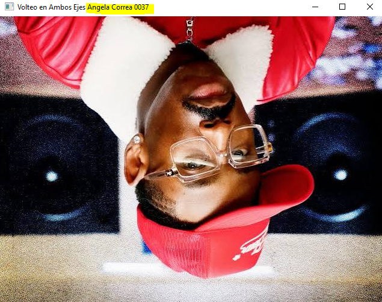
## 10. GUARDADO DE RESULTADOS Y LIMPIEZA
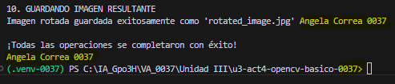